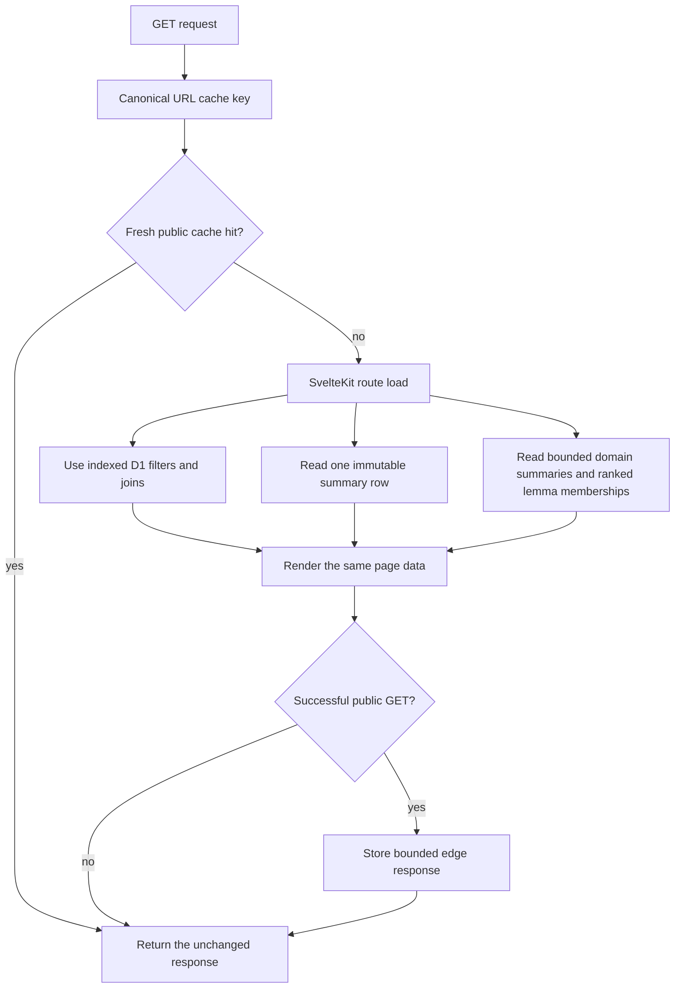

<!-- For God so loved the world, that he gave his only begotten Son, that whosoever believeth in him should not perish, but have everlasting life. — John 3:16 (KJV) -->

# Lexicon read request workflow Chirho

The additive import/deploy migrations refresh the stats, random pools, domain hierarchy summaries, and ranked domain-to-lemma memberships from the authoritative source tables before the Worker version that depends on them is activated. Domain display glosses remain joined from `lemma_entry_chirho`, so a gloss-only sync does not duplicate or stale them. Failed migration or deployment leaves the previously recorded Worker version available for rollback.

